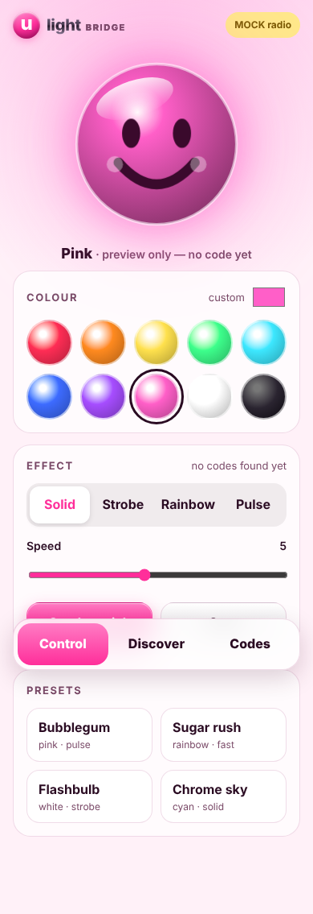
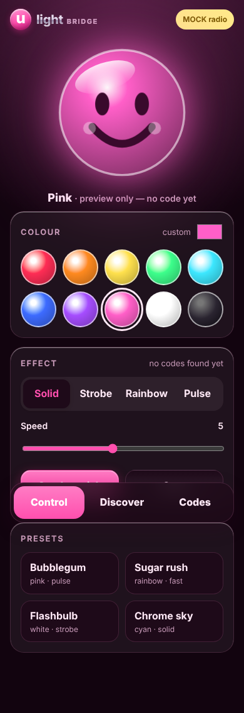
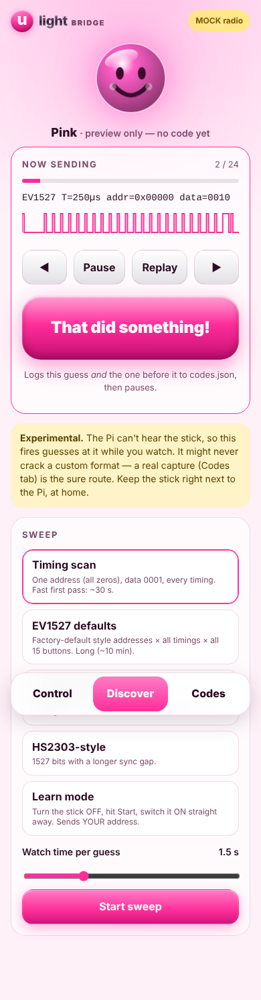

# SS-U-Light — phone bridge for the U-Light fan sticks

Control the pink smiley **U-Light** sticks from a phone browser. No app needed.
A bare **Raspberry Pi Zero 2 W** hosts a dashboard and transmits 433.92 MHz OOK
straight off GPIO 4 using [rpitx](https://github.com/F5OEO/rpitx) (`sendook`).

<p>



</p>

> **Experimental.** We don't know the exact packet format the sticks expect, and a bare
> Pi can only transmit, not listen. The dashboard has a **discovery** mode that fires
> labelled guesses while you watch the stick. It may never crack a custom format.
> The reliable fallback is to import a real capture (Flipper `.sub` / rtl_433 `.ook`).

## What's inside the stick (known facts)

| Part | What it is | Why it matters |
|---|---|---|
| U1 CMT2220LS | CMOSTEK sub-GHz OOK **receiver** | receive-only, so no Bluetooth and no pairing handshake |
| X1 13.52127 MHz | receiver crystal | locks it to **433.92 MHz** |
| U2 FT60E12x | Fremont Micro MCU | decodes the pulses and drives the R/G/B transistors Q1–Q3 |
| `LSD-XLB-B001H/B002H` | board silkscreen | |

## Layout

```
tx/        radio side, no Flask, usable over SSH
  pulses.py          pulse-train type + sendook file format
  encoders.py        EV1527, PT2262/PT2260, HS2303-style, generic PWM, tone
  rpitx.py           THE one function that calls sendook/tune (+ safety limits, mock mode)
  discovery.py       candidate sweeps (timing / EV1527 defaults / PT2262 / HS2303 / learn)
  capture_import.py  Flipper .sub (Princeton + RAW) and rtl_433 .ook parsers
  cli.py             python -m tx.cli tone | ev1527 | pt2262 | plan | import
web/       Flask dashboard (app.py, engine.py = discovery runner + effects, store.py = codes.json)
setup/     install.sh, u-light.service, hotspot.sh
captures/  drop real recordings here
codes.json lab notebook: hits, confirmed button→code mappings, imports
```

## Run it on the Mac (mock radio, nothing transmitted)

```bash
./run_mock.sh
```

Then open http://localhost:8080. The radio pill says **MOCK radio**. Every "transmission" is
logged in the Codes tab with the exact `sendook` command it would have run.

```bash
python3 -m pytest -q
```

## How the radio call works

`tx/rpitx.py → send_pulses()` writes the pulse train in sendook's binary file format
(16-byte `{double active; uint32 duration_ns; uint32 pad}` entries, checked against
`src/ook/sendook.cpp`), then runs:

```
sudo -n sendook -i -f 433920000 -r 8 -p 1 /tmp/ulight-XXXX.ook
```

If that misbehaves on the Zero 2 W, set `ULIGHT_SEND_MODE=string`. That switches to the
plain `sendook -0 T -1 T 1110001…` chip-string mode. Everything else stays the same.

Built-in limits: 433.05–434.79 MHz only, ≤1.5 s on air per burst, ≥120 ms between bursts,
≤20 repeats.

## Safety and etiquette (please read)

- rpitx is **unfiltered**: a square wave off a GPIO pin also radiates harmonics (867, 1301 MHz…).
  Keep it **low-power, short, and at home**, with the stick right next to the Pi. The 17 cm wire
  is plenty. You can also leave it off; a few cm of wire works at arm's length.
- Upgrades for a cleaner signal: a 433 MHz **low-pass filter** on the antenna, or a cheap
  **FS1000A** transmitter module driven by [`rpi-rf`](https://pypi.org/project/rpi-rf/).
  Only `send_pulses()` would need to change.
- **Never transmit at a venue**, and never at anyone else's sticks. These are shared-show
  devices, and jamming or hijacking them ruins it for everyone (and is illegal).
- No secrets live in this repo. You type Wi-Fi passwords into Raspberry Pi Imager or the
  hotspot prompt yourself.

## Art and copy

The smiley, wordmark and palette are original artwork inspired by the glossy Y2K/digicore
vibe. No album art, band logos or other copyrighted material is used.

See **[SETUP.md](SETUP.md)** for the Pi walkthrough and **[PROGRESS.md](PROGRESS.md)** for where we are.
